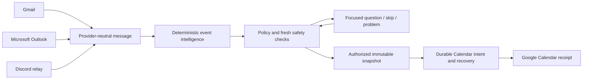

# Calendar Intelligence Hub

A full-stack TypeScript application that turns email and announcement messages into explainable Google Calendar commitments. It reads selected Gmail, Outlook and Discord messages, extracts event facts deterministically, keeps uncertain facts visibly unresolved, flags possible duplicates and scheduling conflicts, and creates Calendar events only after review or an explicit, conservative automation rule.

**Safety order: prevent duplicates → preserve facts → protect privacy → automate.** Extraction and policy are deterministic; the application does not use an LLM.

## The problem

Deadlines and events arrive scattered across mailboxes and community announcements, in inconsistent formats. Copying them into a calendar by hand is tedious; doing it automatically is risky, because a wrong date, a guessed timezone or a duplicated event is worse than a missed one. This project explores how far deterministic extraction plus careful write safety can go, and where a human must stay in the loop.

## Architecture



React + TypeScript + Vite frontend; Node.js + Express API; Prisma + PostgreSQL persistence, organized as an npm-workspace modular monolith. Provider adapters normalize messages into one shape, shared intelligence extracts and validates facts, a separate policy engine decides what may happen, and one shared writer performs Calendar creation. Provider tokens stay on the backend, encrypted at rest. Details: [architecture](docs/ARCHITECTURE.md) and [design decisions](docs/DECISIONS.md).

## What is implemented

| Area                      | Implemented behavior                                                                                               | Verification                                                                                                                                   |
| ------------------------- | ------------------------------------------------------------------------------------------------------------------ | ---------------------------------------------------------------------------------------------------------------------------------------------- |
| Gmail                     | Selected import; optional bounded polling                                                                          | Synthetic tests; selected import and manual Calendar creation previously verified against a real Google account; live polling not yet verified |
| Outlook / Microsoft Graph | Selected organizational-mail import into the shared pipeline                                                       | Synthetic tests only; a real tenant sign-in was blocked by administrator consent                                                               |
| Discord                   | Allowlisted Follow-relay ingestion through a read-only Gateway bot                                                 | Synthetic tests; real permission, manual-channel and Gateway checks only; real Follow delivery not yet observed                                |
| Event intelligence        | Timed/all-day/date-only/unresolved facts with DST handling, readiness blockers, categories, explainable confidence | Unit and integration tests                                                                                                                     |
| Duplicates and conflicts  | Advisory matching against local records and the Google primary calendar                                            | Synthetic tests; bounded real reads previously verified                                                                                        |
| Review                    | Edit, approve, ignore, history, optimistic revision checks                                                         | Unit, integration and browser tests                                                                                                            |
| Automation                | Off by default; Auto/Ask/Skip rules, focused questions, activity feed, operator write gate                         | Synthetic tests; no real automatic Calendar creation performed                                                                                 |
| Calendar writes           | Immutable approved snapshot, durable intent, lost-response recovery                                                | Integration tests including concurrency and interruption scenarios                                                                             |

Current status, test results and limitations: [project state](docs/PROJECT_STATE.md). This project is not production-ready and has not been deployed.

## Engineering highlights

- **Duplicate-safe external writes:** immutable approved payloads, stable provider IDs, payload-hash verification, leases and claim-token fencing support lost-response recovery. User-scoped database locks serialize manual and automatic writes across processes. Exact source replay and semantic event matching are separate checks.
- **Unknown facts remain unknown:** missing dates, uncertain timezones, date-only interpretation and DST ambiguity require focused answers or manual correction. Confidence is evidence, never authorization.
- **Conservative automation:** rules default off. Automatic actions require current facts and provenance, complete untruncated duplicate/conflict coverage and current policy/source/review versions. Possible duplicates and conflicts ask the user. One-time permission never changes a rule.
- **Bounded ingestion and privacy:** Gmail polling persists opt-in windows, cursors, pending work and backoff; Discord uses the official Gateway. Source content expires after 30 days, credentials are encrypted, and explanations avoid copying private bodies into history.

The application never updates, deletes or reschedules Calendar events, never mutates mail or Discord, and makes no LLM calls. These protections cover the application's own operations; they cannot lock unrelated Calendar clients, establish extraction accuracy or guarantee delivery of late-indexed Gmail messages.

## Run locally

Requirements: Node.js 24, npm and PostgreSQL (Docker Compose is an optional database path). Use an empty development database and your own Google OAuth registration.

```sh
npm ci
npm exec prisma generate
```

Follow [local setup](docs/setup.md) to create the ignored `.env`, generate the encryption key, configure your Google OAuth web client and prepare the database. Then:

```sh
npm run db:migrate
npm run dev
```

Open [http://localhost:5173](http://localhost:5173); the API listens on port 3000. Optional [Microsoft](docs/microsoft-setup.md) and [Discord](docs/discord-setup.md) inputs require authorization from the account or server owner. Automation and polling start disabled; see [automation setup](docs/automation-setup.md).

## Tests without real accounts

The automated suites use synthetic Google, Microsoft and Discord responses with a real local PostgreSQL database, HTTP server, sessions and browser. No provider account is needed, and these tests do not establish live provider compatibility.

```sh
npm test                 # unit, API and UI
npm run typecheck
npm run build
# Integration and browser tests need a separate, disposable database whose name ends in _test:
DATABASE_URL="$TEST_DATABASE_URL" npm run db:migrate
npm run test:integration
npm exec playwright install chromium   # once
npm run test:e2e
npm run format:check
```

Never point `TEST_DATABASE_URL` at meaningful data. See [CONTRIBUTING.md](CONTRIBUTING.md) for the database safeguards.

## Documentation

- [Architecture](docs/ARCHITECTURE.md), [decisions](docs/DECISIONS.md) and [project state](docs/PROJECT_STATE.md)
- [Code walkthrough](docs/walkthrough.md)
- [Local setup and Google OAuth](docs/setup.md), [Microsoft setup](docs/microsoft-setup.md), [Discord setup](docs/discord-setup.md) and [Discord research notes](docs/discord-research.md)
- [Automation safety](docs/automation-safety.md) and [automation setup](docs/automation-setup.md)

## Development, license and security

Development used AI assistance for implementation, automated tests and review. Test counts and commit history should not be read as proof of individual authorship of every subsystem. This repository starts from a fresh initial commit; earlier development history is kept in a private archive.

[MIT license](LICENSE). Dependencies retain their own licenses. Read [SECURITY.md](SECURITY.md) before reporting a vulnerability and [CONTRIBUTING.md](CONTRIBUTING.md) before sharing fixtures or logs. Never publish credentials, private messages or account data.
