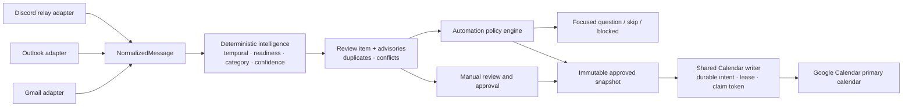

# Architecture

Calendar Intelligence Hub is a TypeScript npm-workspace **modular monolith**: one Express API process, one PostgreSQL database and a React single-page frontend. This document describes the implemented system; rationale is in [DECISIONS.md](DECISIONS.md) and current verification status in [PROJECT_STATE.md](PROJECT_STATE.md).

## Repository layout

| Path                                         | Responsibility                                                                                                                                                            |
| -------------------------------------------- | ------------------------------------------------------------------------------------------------------------------------------------------------------------------------- |
| `packages/contracts/src/`                    | Shared types and Zod schemas: `NormalizedMessage`, temporal shapes, readiness, categories, confidence, duplicates, conflicts, automation policy/reason codes, HTTP errors |
| `apps/api/src/domain/events/`                | Pure deterministic functions: classification, date/time/timezone parsing, extraction, categorization, validation. No database or network access                           |
| `apps/api/src/application/`                  | Use-case orchestration: import, processing, review save/approve/ignore, duplicate checks, Calendar creation, Discord ingestion                                            |
| `apps/api/src/application/automation/`       | Policy store, decision engine, focused questions, activity feed, Gmail polling scheduler, cross-process action locks                                                      |
| `apps/api/src/infrastructure/`               | Provider gateways (`google/`, `microsoft/`, `discord/`), token vault, sessions/CSRF, Prisma persistence and retention                                                     |
| `apps/api/src/routes/`, `middleware/`        | HTTP boundary: authentication, request validation, ownership, safe errors                                                                                                 |
| `apps/web/src/features/`                     | Activity, automation settings and questions, connections, message selection, review detail/advisories, history                                                            |
| `prisma/schema.prisma`, `prisma/migrations/` | Schema and five reviewed SQL migrations                                                                                                                                   |
| `tests/integration/`, `tests/e2e/`           | PostgreSQL integration tests and Playwright browser tests against synthetic provider gateways                                                                             |
| `tools/discord-smoke.ts`                     | Standalone read-only Discord check; never imported by the API                                                                                                             |

## Inputs

All adapters implement one `MessageSourceAdapter` shape (`list`, `get`, `normalize`) and produce the same `NormalizedMessage`. There is one intelligence pipeline, not one per provider.

- **Gmail** (`infrastructure/google/gmail.ts`, `mime.ts`): lists message metadata, fetches only selected bodies, validates MIME and prefers plain text with a safe HTML-to-text fallback. Selected import accepts at most 20 IDs per request. Optional bounded polling (below) uses the same gateway. Read-only scope; no mailbox writes.
- **Outlook** (`infrastructure/microsoft/`): one configured organizational tenant via the MSAL confidential Web client with S256 PKCE, state and nonce; delegated `Mail.Read` plus OIDC scopes. Selected import only; automatic Graph polling is not implemented.
- **Discord** (`infrastructure/discord/`): an allowlisted guild/channel relay fed by Discord's channel Follow feature, read by a bot through the official Gateway (Guilds, Guild Messages and Message Content intents) in a worker thread, with capped REST recovery of recent history. Read-only; no Discord writes, user tokens or scraping. Source edits/deletions are recorded as changes that require user confirmation, never as inferred cancellations.

Message bodies are capped at 256 KiB decoded. Content is treated as untrusted text.

## Intelligence and review

`application/processMessage.ts` runs domain functions over the normalized message and user timezone:

- **Temporal facts** use explicit variants: timed (UTC instants plus the IANA zone used to interpret them, with explicit/assumed/user-confirmed provenance), all-day (dates with exclusive end), date-only and unresolved. Missing years, ambiguous numeric dates, nonexistent or repeated DST times and multiple dates stay unresolved rather than guessed.
- **Readiness** derives structured blockers (title, date, interval, timezone) that gate approval; it is enforced in the UI, in backend approval and again when claiming a write.
- **Category** and **confidence** are explainable, deterministic and separate from readiness. Confidence explains the original extraction; it never authorizes anything.
- **Duplicate** and **conflict** advisories compare against owner-scoped local records and bounded reads of the Google primary calendar. Exact identity (same source, same protected write) is distinct from possible semantic matches; partial coverage is reported as partial.

Each message has one `DetectedEvent` (extraction evidence) and one `ReviewItem` (editable draft, revision, status, approved snapshot). Edits use optimistic revision checks, so stale browser tabs receive a 409 conflict.

## Calendar writes

Manual approval and automatic actions use the same writer (`application/createCalendarEvent.ts`, `infrastructure/persistence/calendarWrites.ts`):

1. A short transaction locks the review row and creates or reuses one durable write intent holding a stable provider event ID, the approved payload and its hash, a 60-second lease and a claim token.
2. The Google insert happens outside any database transaction.
3. A lost response is recorded as unknown, not failed or added. Retry first reads the saved event ID and accepts it only if the fetched payload hash matches; stale claim tokens cannot finalize a newer claim.

Writes go only to the signed-in account's primary calendar. Updates, deletions and rescheduling are not implemented. This is replay protection for the application's own writes, not a global exactly-once guarantee across other Calendar clients.

## Automation

Automation is off by default and layered on top of review:

- `AutomationPolicy` holds enabled state, Gmail polling opt-in and constrained Auto/Ask/Skip rules scoped to a source connection, category and optionally a Discord channel. Skip beats Ask beats Auto; no match asks.
- `application/automation/engine.ts` reloads owned facts, runs fresh duplicate/conflict checks, verifies policy/source/review versions and records a decision (`auto_handle`, `ask_user`, `skip`, `blocked`) with fixed reason codes before calling the shared writer.
- Focused questions request only missing facts, duplicate/conflict decisions or one-time permission; answers are revision-bound and applied transactionally.
- `AutomationScheduler` ticks every 60 seconds in the API process. Gmail polling uses a persisted watermark, windows of at most one hour, one page of at most 20 IDs per run, pending-ID cursors that survive restart and capped exponential backoff.
- A user-scoped PostgreSQL advisory lock (separate pool of at most 4 connections) serializes automatic and manual Calendar actions across processes.
- The server-only `AUTOMATION_LIVE_WRITES_ENABLED` gate must be the literal `true` before automatic creation can reach Google; it is not exposed through the API.

## Identity, sessions and HTTP boundary

- Google OpenID Connect is the workspace identity. OAuth state is random, stored hashed, bound to the browser session, single-use and expires after 10 minutes; PKCE (S256) and nonce are verified; the email must be verified; a different Google account than the session's is rejected; the session is rotated after login.
- Sessions are 256-bit random tokens stored only as SHA-256 hashes, sent as an `HttpOnly`, `SameSite=Lax` cookie (`Secure` in production), with 8-hour expiry.
- Every state-changing request requires an exact `Origin` match and a constant-time-compared synchronizer CSRF token.
- Every data route uses `requireActor`, and queries are scoped by the session's user ID. Raw SQL uses parameterized `Prisma.sql` templates only.
- Responses carry a restrictive Content-Security-Policy, `nosniff`, `no-referrer` and `no-store`; JSON bodies are limited to 300 KB. Errors return fixed codes plus a request ID; logs contain fixed codes, request IDs and counts only.
- The API binds to `127.0.0.1`. In development, Vite (port 5173) proxies `/api` and `/auth` to the API (port 3000). In production mode the API serves the built frontend and requires HTTPS origins.

## Persistence and privacy

Prisma models: `User`, `Session`, `OAuthState`, `GoogleAuthorization`, `MicrosoftAuthorization`, `SourceConnection`, `NormalizedMessage`, `DetectedEvent`, `ReviewItem`, `CalendarEvent`, `ProcessingAttempt`, `HistoryEntry`, `DiscordRelay`, `DiscordObservation`, `AutomationPolicy`, `AutomationDecision`, `AutomationQuestion`, `IngestionPoll`.

- Google refresh tokens and the serialized MSAL token cache are encrypted with AES-256-GCM using `TOKEN_ENCRYPTION_KEY` (64 hex characters), kept outside the database.
- Source identity is unique per connection and external message ID, so re-import returns the existing record.
- Original message content expires 30 days after ingestion; expiry is enforced on read and purged at server startup, and users can erase content earlier. Review facts and safe history remain.
- History and automation records store fixed codes, versions and fingerprints rather than copies of source bodies.

## Startup behavior

`apps/api/src/server.ts` validates configuration, purges expired source content, starts the Discord runtime when Discord variables are configured, starts the automation scheduler and listens on loopback. Starting the real server against a database with persisted opt-ins can therefore trigger provider reads.

## Known gaps

Expired `Session` and `OAuthState` rows are rejected on read but not periodically deleted. There is no rate limiting, deployment configuration or CI workflow. Production hosting has not been assessed; see [PROJECT_STATE.md](PROJECT_STATE.md).
